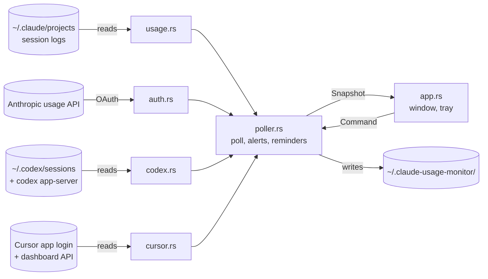

# Architecture

How Clauddy is put together: the parts, how they talk, where each piece of code lives and what it keeps on disk.

## Overview

Clauddy is one native app, in Rust, in `native/` ([ADR-012](../decisions/ADR-012-the-native-app-replaces-electron.md)). A **poller thread** reads usage from its sources every few seconds and publishes a snapshot; the **window** draws the pet, the numbers and Settings from it with egui, and sends back what the user changed. Nothing runs outside the app: there is no server and no account of ours. The `clauddy` command on npm only downloads and starts the app ([ADR-014](../decisions/ADR-014-npm-launches-the-native-app.md)).

The **percentages** come from each service's own account ([usage](04-usage.md)). The **token counts**, breakdowns and activity come from local logs. Every reading stays on the machine. The threads, the screens and the window on macOS are in [the native app](08-native.md).

## Stack

| Piece | What | Version |
|---|---|---|
| Language | [Rust](https://www.rust-lang.org) | stable (`native/Cargo.toml`) |
| UI | [eframe/egui](https://github.com/emilk/egui): immediate mode, drawn on the GPU, repainted only on change | 0.37 |
| Tray | [tray-icon](https://github.com/tauri-apps/tray-icon) | `native/Cargo.toml` |
| macOS | [objc2](https://github.com/madsmtm/objc2) for the window, notifications, login item and sound | `native/Cargo.toml` |
| Launcher | Node script, no dependencies; [Bun](https://bun.sh) runs its test, [Biome](https://biomejs.dev) lints it | `package.json` |
| Releases | [semantic-release](https://semantic-release.gitbook.io) on every merge to `main` | `.releaserc.json` |

## Where the code lives

| Where | What |
|---|---|
| `native/src/` | The app ([code layout](08-native.md#code-layout)) |
| `native/assets/` | The pets' sprite sheets, the app and tray icons, the service logos |
| `native/scripts/` | `bundle.sh` (the macOS app), `package.sh` (a release artifact), `icon.sh` (the `.icns`) |
| `native/tests/snapshots/` | The snapshot gallery: every screen state as a PNG |
| `bin/clauddy.js` | The npm launcher |
| `install.sh` | The macOS installer ([setup](03-setup.md#macos)) |

## Data on disk

Everything Clauddy keeps lives in `~/.claude-usage-monitor/`, on every platform and however it is run:

| File | Holds |
|---|---|
| `auth.json` | The OAuth token, file mode `600`, never committed |
| `config.json` | Settings ([every key](03-setup.md#configure)) |
| `accounts.json` | The account list and the active one |
| `alerts.json` | Which notifications are armed, so a restart does not repeat them |
| `reset-reminders.json` | Reminder deadlines and the ones recently delivered |
| `accounts/<id>/` | `auth.json` and `alerts.json` of each extra account; the first account keeps the top-level files |
| `native-ui.json`, `native-voice.json`, `limits-cache.json` | The size and open sections, the once-a-day remarks, the last reading per account |
| `bin/<version>/` | The app as the npm launcher downloaded it |

With Codex connected, Clauddy also reads (never writes) `~/.codex/sessions` and starts Codex's app-server, which asks OpenAI for the limits with Codex's own login. With Cursor connected, it reads the Cursor app's login and `~/.cursor/projects`, also without writing. Clauddy itself sends nothing else: only the OAuth and usage calls to Anthropic, the release check to GitHub and, with Cursor connected, the usage calls to Cursor with the Cursor app's token.

## Tests

`cargo test --release` in `native/` runs the unit tests and the snapshot gallery ([the native app](08-native.md#tests)). `bun run test` runs the launcher's test. Pull requests run both, and build the app on macOS, Windows and Linux.
