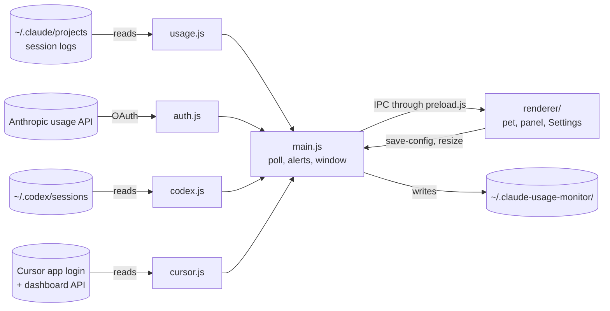

# Architecture

How Clauddy is put together: the parts, how they talk, where each piece of code lives and what it keeps on disk.

## Overview

Clauddy is one Electron app. The **main process** (`main.js`, Node) reads usage from its sources every few seconds and sends it to the **renderer** (`renderer/`, the widget's web page) through a small bridge (`preload.js`). The renderer draws the pet, the numbers and Settings, and sends back what the user changed. Nothing runs outside the app: there is no server and no account of ours.

The **percentages** come from each service's own account ([usage](04-usage.md)). The **token counts**, breakdowns and activity come from local logs. Every reading stays on the machine.

## Stack

| Piece | What | Version |
|---|---|---|
| Shell | [Electron](https://www.electronjs.org): a frameless, transparent, always-on-top window | 42 (`package.json`) |
| Runtime | Node, for the main process | 24 (`.nvmrc`) |
| Scripts | [Bun](https://bun.sh): install, tests, scripts | 1.4 |
| Widget | Vanilla JS, SVG and CSS/WAAPI animations, no framework | — |
| Format and lint | [Biome](https://biomejs.dev) | `biome.json` |
| Builds | [electron-builder](https://www.electron.build), one runner per OS | `package.json` → `build` |
| Releases | [semantic-release](https://semantic-release.gitbook.io) on every merge to `main` | `.releaserc.json` |

## Where the code lives

| File | What it does |
|---|---|
| `main.js` | The main process: the window and its modes, the poll, notifications, file watchers, the tray, self-update |
| `preload.js` | The bridge: every channel the renderer may send or listen on, and nothing else |
| `usage.js` | Reads `~/.claude/projects/**/*.jsonl` incrementally: tokens, the 5-hour session window, whether a turn is open, the current activity |
| `auth.js` | OAuth login (PKCE) and the call that returns the account's real session and weekly % |
| `accounts.js` | The account list: several Claude subscriptions, one active at a time |
| `codex.js` | Reads Codex's `~/.codex/sessions/**/rollout-*.jsonl`: limits, tokens, 30-day history |
| `cursor.js` | Cursor: usage % from its dashboard API with the token the Cursor app keeps in `state.vscdb`, activity from `~/.cursor/projects` |
| `reminders.js` | One-shot session reset reminders, kept on disk, keyed by provider and account |
| `renderer/index.html`, `pet.js`, `style.css`, `motion.css` | The widget: the pet, the panel, Settings, every size |
| `renderer/pets.js`, `pets.css` | The selectable pets, their packs and the holiday rule ([pets](06-pets.md)) |
| `renderer/burn.js` | The burn-rate projection ([usage](04-usage.md#burn-rate)) |
| `renderer/companion.js` | Provider activity transitions and their shared cooldown |
| `renderer/voice.js` | The remarks in the speech bubble and the chiptune blips |
| `make-icon.js`, `make-ico.js`, `make-tray.js`, `build-icon.sh` | The app, Windows and tray icons, generated from the pixel sprite |
| `scripts/adhoc-sign.js` | Ad-hoc signs the macOS bundle with the real app id; without it macOS drops the app's notifications |
| `pet`, `bin/` | The `./pet <state>` simulator and the `clauddy` command ([setup](03-setup.md#play-with-the-pet)) |
| `tools/showcase/` | The product video, rendered from the real widget ([its README](../../tools/showcase/README.md)) |

`renderer/pet.js`, `burn.js`, `voice.js`, `companion.js` and `pets.js` end with a `module.exports` guard, so one file runs as a `<script>` in the widget and as an import in the tests.

## Data on disk

Everything Clauddy keeps lives in `~/.claude-usage-monitor/`, on every platform and however it is run:

| File | Holds |
|---|---|
| `auth.json` | The OAuth token, file mode `600`, never committed |
| `config.json` | Settings ([every key](03-setup.md#configure)) |
| `accounts.json` | The account list and the active one |
| `alerts.json` | Which notifications are armed, so a restart does not repeat them |
| `reset-reminders.json` | Reminder deadlines and the ones recently delivered |
| `debug.json` | The simulator's forced state |
| `accounts/<id>/` | `auth.json` and `alerts.json` of each extra account; the first account keeps the top-level files |

With Codex connected, Clauddy also reads (never writes) `~/.codex/sessions`. With Cursor connected, it reads the Cursor app's login and `~/.cursor/projects`, also without writing. Nothing leaves the machine except the OAuth and usage calls to Anthropic and, with Cursor connected, the usage calls to Cursor with the Cursor app's token.

## Tests

The suite runs as three separate processes, one per folder, because bun mocks are per process ([ADR-002](../decisions/ADR-002-three-test-processes.md)):

| Folder | Covers | Mocks |
|---|---|---|
| `test/unit/` | `usage.js`, `auth.js`, `codex.js`, `cursor.js`, `accounts.js`, `reminders.js` and the renderer's pure modules | none |
| `test/main/` | `main.js` | `electron`, `./usage`, `./auth`, `./codex`, `./cursor` |
| `test/dom/` | `renderer/pet.js`, `preload.js` | happy-dom for the page |

`bun run test` runs all three; `bun run test:coverage` adds the coverage gate ([ADR-003](../decisions/ADR-003-coverage-counts-every-file.md)).
