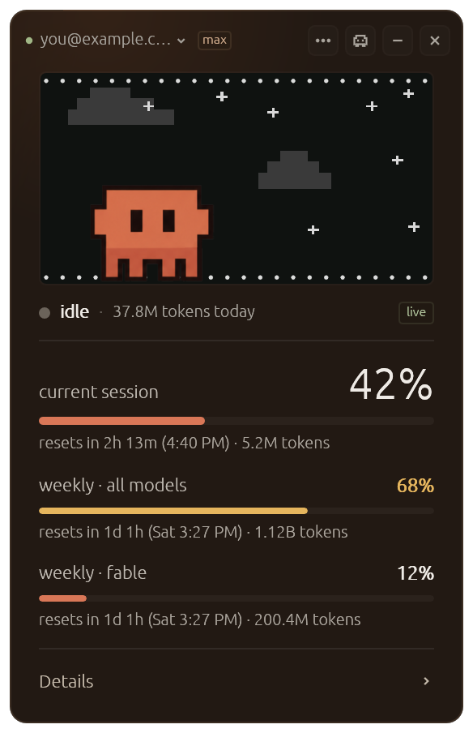
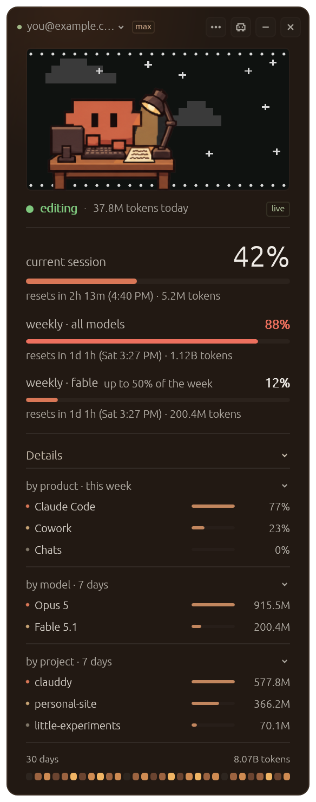
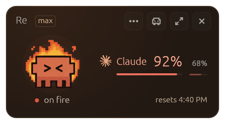

# Features

What Clauddy shows and does: the panel, its sizes, the pet's moods and what the pet says.

## The panel

| Row | What it shows | Source |
|---|---|---|
| Current session | Real % used, `resets in Xh Ym`, session tokens, and where the pace is taking you ([burn rate](04-usage.md#burn-rate)) | Account % · local logs |
| Weekly · all models | Real % used and tokens over the last 7 days | Account % · local logs |
| Weekly · one model | A model's own weekly limit (`weekly · fable`), with the most of the week it may take beside it, smaller, when the plan says (`up to 50% of the week`) | Account % · local logs |
| Status line | `● working · 1.6M tok/min`, or today's tokens when idle | Local logs |
| By product · this week | What Claude Code, Cowork and Chats each took of the week, in %, the biggest first | Account |
| Span | **today**, **7 days** or **30 days**: what Claude's lists below cover | Local logs |
| By model | Opus, Sonnet, Haiku, Fable, in tokens | Local logs |
| By project | Which repository used the span, ranked, the tail folded into `other`. A session started in a subdirectory or in a worktree counts for its repository; a click on a row opens that project: its models, its last 7 days, its worktrees and its cache share ([usage](04-usage.md#projects)) | Local logs |
| Top sessions | The five heaviest sessions of the span, by tokens ([usage](04-usage.md#spans-a-project-in-detail-sessions)) | Local logs |
| 30-day map | One square per day, green (light) to red (heavy), with the monthly total | Local logs |

On a Claude plan with no 5-hour window (the usage response has no `five_hour`), the week takes the session's place: it leads the panel once, and the compact rows, the pet's glance, the menu bar, the mood and the alerts follow it. An idle session that only lacks a reset time is still a session.

Everything is in tokens and percent, never in dollars. Without a connected account the limits area asks to connect instead of guessing a % ([usage](04-usage.md)).

## Sizes and controls

| Size | What it is | How to get there |
|---|---|---|
| Expanded | The scene, the session, the week and the details | The default; **⤢** from compact |
| Compact | The pet beside one row per connected service: the session % and its bar, and on the right, smaller and dimmer, the week's % over a shorter bar of its own (hovering it shows a small tag with the week's reset); no week on a weekly-only plan, whose session already is the week, nor for Cursor | **–** in the title bar |
| Just the pet | The pet alone, floating, with the usage always above it as the pet's own speech bubble: per service, the session % and the week's % beside it, a bar for each; hovering the pet or the bubble slides out the **⤢** that opens compact | The pet icon in the compact header (floating mode only) |

- **Drag** the widget anywhere; in pet-only mode drag the pet itself. Enter on the focused pet opens compact.
- **⋯**, in the title band of expanded and compact, opens a small menu: **Change pet** (the pet picker on its own: a pick takes at once, no Save), **Settings** (**Accounts**, **Alerts** and **Appearance** tabs) and **Usage page** (the official one of the service on screen); at its foot, the version with **Check for updates**. When a newer release is out, the dots of ⋯ turn coral and ripple now and then, and the foot becomes a card with **Update**. **×** quits.
- **Notify at reset**, under the session, arms a one-shot notification for when the session resets ([alerts](05-alerts.md)).
- The chosen size is remembered.

### Floating or menu bar

**⚙ Settings → Appearance → Lives in** picks where Clauddy lives:

- **Floating**: the always-on widget in a corner (the default).
- **Menu bar**: a pet icon in the menu bar with the hottest session % beside it (🔥 near the limit). Its menu opens the panel under the icon, switches back to floating or quits; a click away closes the panel, and **–** in its title band hides it. On Windows and Linux the icon lives in the system tray, the same pet in its coral (nothing tints a template there, and black vanishes on a dark taskbar), and the % shows in its tooltip.

Switching takes effect at once, with no restart.

## Moods

| | | |
|---|---|---|
|  |  |  |
| **idle**: breathes and blinks | **working**: types at the desk | **on fire**: session past the fire threshold (90% by default), flames |

**Maxed out** (the session at 100%) slumps and sweats, and **sleeping** (idle 5+ minutes) closes its eyes under a "Z z". The pictures come from the snapshot gallery in `native/tests/snapshots/`, which has every state; the other pets have every mood in their own look ([pets](06-pets.md)).

In compact and pet-only sizes the mood follows whichever connected service is working, with provider logos naming the workers. With none active, the hottest session sets the mood: on fire past the fire threshold, maxed out at 100%, resting otherwise; the logo of the service on fire takes the status dot's place. "Working" means a turn is open, not that a file was written recently ([ADR-006](../decisions/ADR-006-working-means-an-open-turn.md)). What Claude is doing (reading, editing, running, planning, researching, delegating, waiting) shows in the status line.

## Just the pet at play

In pet-only size the pet doesn't only stand in its corner. Now and then, on its own, each pet does a number of its own on the screen, drawn on a see-through window over everything that clicks go through ([ADR-019](../decisions/ADR-019-the-pet-plays-on-a-window-over-the-screen.md)).

### When it plays

| What | When | How long |
|---|---|---|
| The pet's number | 90 seconds after launch, then once every 12 to 20 minutes (a random wait each time) | See below |
| Clauddy hops onto the window in front | A Claude Code turn of a minute or more ends | About 15 s: it sits there 12 s |
| A throw (macOS) | You drag the pet and let go fast | Until it lands, then 1.8 s of stars |

Nothing plays while the pet sleeps (no Claude Code activity for 5 minutes), outside pet-only size, in the menu bar, while Settings is open, or with **Plays on the screen** off. A number that comes due while the pet sleeps is skipped, and the next one waits its 12 to 20 minutes.

| Pet | How long its number lasts, about |
|---|---|
| Clauddy | 7 s |
| Getaway | 10 to 12 s (longer on a wider screen) |
| Santa | 13 s for the sleigh; the snow falls 45 s, and the presents rest 7 s where they land |
| Gingerbread | 18 s of dare, then the run home |
| Reindeer | 9 s |
| Wizard | 5 s |
| Astronaut | 13 s of flight, then the flight home |
| Pumpkin | 3 s of cackling; the bats fly a few seconds more and the ghost follows the cursor 7 s |

### What each pet does

| Pet | Its number |
|---|---|
| **Getaway** | Takes the car down to the top of the Dock (or the taskbar), drives off the right side of the screen leaving puffs of exhaust, comes back in from the left, stops halfway to wave at you, and hops back up to its place |
| **Santa** | Flies his sleigh and two reindeer across the top of the screen with snow falling along, waves as he passes the middle, and drops four presents: three along the way and one right over your cursor. They land on the window edges or the floor, rest a few seconds and go. The sleigh comes back down to his place, and the snow keeps falling round him a while |
| **Gingerbread** | Hops down to the floor and dares you: it jogs back and forth on its own, stops now and then to tease (tongue out, hands at its ears), and sprints away from the cursor whenever it comes near. Cornered at the screen's edge, it leaps over the cursor. After 18 seconds it runs home |
| **Reindeer** | Takes off in an arc off the right side of the screen, comes back from the left up high with its nose aglow and waving, and lands home, leaving a trail of sparkles |
| **Wizard** | Vanishes in a poof, reappears on top of a window in reach (or on the floor), raises its wand and shoots sparks at your cursor, waves, and poofs home |
| **Astronaut** | Takes off on a little rocket and cruises round the screen for 13 seconds from one spot to the next, its nose turned the way it goes, waving as it passes the middle, then flies home |
| **Pumpkin** | Cackles while eight bats fly out of its mouth and off the screen; then a little ghost comes out and follows your cursor for a few seconds |
| **Clauddy** | Plays peekaboo: hops onto the top edge of the window in front, drops behind it, peeks over the edge (only its head and eyes show), ducks, peeks again further along with a wave, and hops out and home. With a window filling the screen, it hides behind the bottom of the screen, over the Dock. When a Claude Code turn of a minute or more ends, it also hops onto the window in front, to tell you |

On macOS any pet can also be **thrown**: drag it and let go fast, and it flies, bounces off the screen's sides, lands on a window edge or the floor, sees stars, and stays where it landed. A window that moves or closes under the pet drops it to whatever is below. Clauddy reads where other apps' windows are, never what they show; on Linux it reads no windows, so the pet lands only on the floor.

**⚙ Settings → Appearance → Plays on the screen** turns all of it off; it is on by default. The classic Clauddy can also wear a hat, picked under the pets in the pet picker ([pets](06-pets.md#hats-and-play)).

## The pet talks

Now and then the pet says something in a speech bubble. It speaks only when something changes, never on a timer, and keeps quiet when it has nothing specific to say. Remarks are at least 10 minutes apart; the big moments can cut that line.

| Moment | Expanded | Minimized | Blip |
| --- | --- | --- | --- |
| First launch of the day | _Good morning! Yesterday was your heaviest day this week, 12M tokens._ | _Morning! Big day yesterday._ | ✓ |
| The afternoon, with the app still open | _Good afternoon! 18M tokens so far today, the session's at 42%._ | _Afternoon! 18M today._ | ✓ |
| The evening, with the app still open | _Good evening! Big day, 40M tokens, your heaviest this week._ | _Evening! Big day today._ | ✓ |
| Session crosses the fire threshold | _Getting warm, 91% already. At this pace you'll run out in about 40m._ | _91%, getting warm!_ | ✓ |
| The session window resets | _Fresh window! That was 34M tokens over 4h 12m, mostly editing code._ | _Fresh window! 34M last time._ | ✓ |
| The session hits 100% | _That's the limit. I'll be back at 2:35 PM._ | _Maxed out till 2:35 PM._ | |
| Back after 2+ hours away | _Welcome back! You were gone 3h 12m. The session's at 12%._ | _Welcome back!_ | |
| 90 minutes of unbroken work | _You've been at it for 1h 35m straight. Stretch break?_ | _Stretch break?_ | |
| A new record day (30-day best) | _New record! 45M tokens today, your biggest day in a month._ | _New record: 45M!_ | |
| Codex crosses fire, hits 100% or resets | _Codex is at 91% now. It resets in 1h 12m._ | _Codex at 91%!_ | ✓ (fire, reset) |
| Cursor crosses fire, hits 100% or starts a new month | _Cursor is at 91% now. It resets in 6d 4h._ | _Cursor at 91%!_ | ✓ (fire, reset) |

The greeting follows the clock (_Good morning_, _Good afternoon_, _Good evening_, or _Still up?_ before 5 AM) and comes once a day, as does the record. With the app left open, the afternoon and the evening each get one more hello about today; if you're away when one comes due, it waits until you're back. The reset recap covers only what the pet saw, so launched mid-session it says less. A click dismisses the bubble.

### The voice

Optionally the pet **blips** as it talks: short chiptune notes, one per letter, made live (square waves, no sound files). macOS only for now. Faster and higher on fire, slower and lower when sleepy. Only the headline moments blip (the ✓ rows), because a sound on every remark wears out fast.

- **Off by default.** **⚙ Settings → Appearance → Chiptune voice** turns it on and plays a sample.
- **Always silent** in menu-bar mode and outside the expanded size.

**Speech bubbles** can be turned off in the same place.
