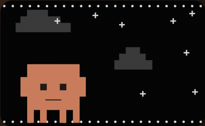
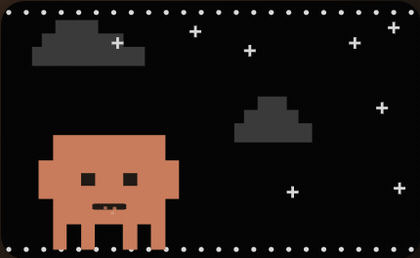
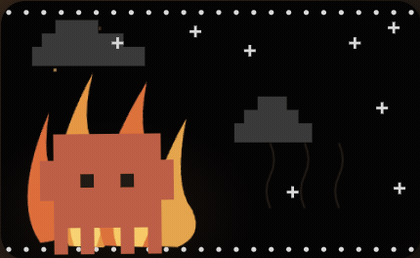
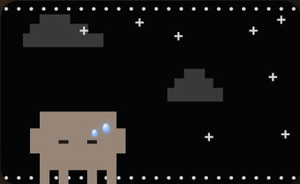
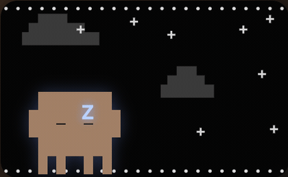
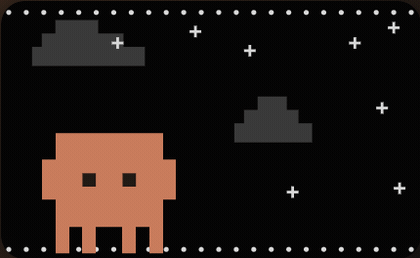
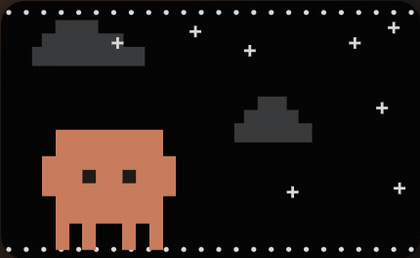
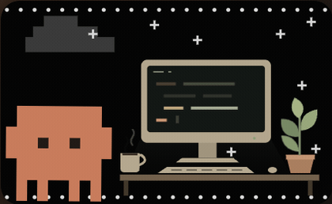
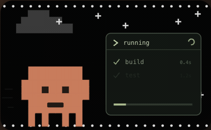

# Features

What Clauddy shows and does: the panel, its sizes, the pet's moods and activity scenes, and what the pet says.

## The panel

| Row | What it shows | Source |
|---|---|---|
| Current session | Real % used, `resets in Xh Ym`, session tokens, and where the pace is taking you ([burn rate](04-usage.md#burn-rate)) | Account % · local logs |
| Weekly · all models | Real % used and tokens over the last 7 days | Account % · local logs |
| Status line | `● working · 1.6M tok/min`, or today's tokens when idle | Local logs |
| By model · 7 days | Opus, Sonnet, Haiku, Fable, in tokens | Local logs |
| By project · 7 days | Which repo used the week, ranked, the tail folded into `other` | Local logs |
| 30-day map | One square per day, green (light) to red (heavy), with the monthly total | Local logs |

Everything is in tokens and percent, never in dollars. Without a connected account the limits area asks to connect instead of guessing a % ([usage](04-usage.md)).

## Sizes and controls

| Size | What it is | How to get there |
|---|---|---|
| Expanded | The scene, the session, the week and the details | The default; **⤢** or a double-click on the pet from compact |
| Compact | The pet in a ring of the live session %, or one line per service when more than one is connected | **–** in the title bar |
| Just the pet | The pet alone, floating; hovering it (or focusing it) shows the usage as the pet's own speech bubble, one bar per service | The pet icon in the compact header (floating mode only) |

- **Drag** the widget anywhere; in pet-only mode drag the pet itself. Enter on the focused pet opens compact.
- **⚙** opens Settings: **Accounts**, **Alerts** and **Appearance** tabs.
- **↗** opens the official Usage page of the service on screen. **×** quits.
- The chosen size is remembered.

### Floating or menu bar

**⚙ Settings → Appearance → Lives in** picks where Clauddy lives:

- **Floating**: the always-on widget in a corner (the default).
- **Menu bar**: a pet icon in the macOS menu bar with the live session % (🔥 near the limit; with Codex or Cursor too it reads `C 64% · X 28% · Cu 5%`). A click opens the panel as a popover pointing at the icon; a click away closes it; a right-click opens a quick menu. On Windows and Linux the icon lives in the system tray and the % shows in its tooltip.

Switching takes effect at once, with no restart.

## Moods

<table>
  <tr>
    <td align="center"> <b>idle</b> breathes and blinks</td>
    <td align="center"> <b>working</b> hops and eats token coins</td>
  </tr>
  <tr>
    <td align="center"> <b>on fire</b> session ≥ 90%: red, shivers, flames</td>
    <td align="center"> <b>maxed out</b> session at 100%: drained, slumped, sweating</td>
  </tr>
  <tr>
    <td align="center"> <b>sleeping</b> idle 5+ min: blue zzz and moonlight</td>
    <td align="center"> <b>poke</b> click the pet: squish and hearts</td>
  </tr>
  <tr>
    <td colspan="2" align="center"> <b>celebrate</b> the session resets: jump and confetti</td>
  </tr>
</table>

Plus a welcome **wave** on launch. The GIFs show the classic sprite; the other pets keep every mood with their own look ([pets](06-pets.md)).

In compact and pet-only sizes the mood follows whichever connected service is working, with provider logos naming the workers. With none active, the hottest session sets the mood: on fire past the fire threshold, maxed out at 100%, resting otherwise; the logo of the service on fire takes the status dot's place. "Working" means a turn is open, not that a file was written recently ([ADR-006](../decisions/ADR-006-working-means-an-open-turn.md)).

### What Claude is up to

While Claude Code works, the pet sets up a small scene that mirrors what it is doing now, read from the last tool it used:

<table>
  <tr>
    <td align="center"> <b>reading</b> an open book under the lamp</td>
    <td align="center"> <b>editing</b> types at the desk, coffee in reach</td>
  </tr>
  <tr>
    <td colspan="2" align="center"> <b>running</b> watches a task log tick through its checks</td>
  </tr>
</table>

**Planning**, **researching**, **delegating** and **waiting** show in the status line. When Claude goes quiet the pet goes back to plain working or idle.

### Provider reactions

When a service's activity changes, the pet's eyes glance toward it, with no caption. The glance never changes the selected service, and glances share a 30-second cooldown. A first reading only sets the baseline, and going quiet counts as a pause, not a finished task.

## The pet talks

Now and then the pet says something in a speech bubble. It speaks only when something changes, never on a timer, and keeps quiet when it has nothing specific to say. Remarks are at least 10 minutes apart; the big moments can cut that line.

| Moment | Expanded | Minimized | Blip |
| --- | --- | --- | --- |
| First launch of the day | _Good morning! Yesterday was your heaviest day this week, 12M tokens._ | _Morning! Big day yesterday._ | ✓ |
| Session crosses the fire threshold | _Getting warm, 91% already. At this pace you'll run out in about 40m._ | _91%, getting warm!_ | ✓ |
| The session window resets | _Fresh window! That was 34M tokens over 4h 12m, mostly editing code._ | _Fresh window! 34M last time._ | ✓ |
| The session hits 100% | _That's the limit. I'll be back at 2:35 PM._ | _Maxed out till 2:35 PM._ | |
| Back after 2+ hours away | _Welcome back! You were gone 3h 12m. The session's at 12%._ | _Welcome back!_ | |
| 90 minutes of unbroken work | _You've been at it for 1h 35m straight. Stretch break?_ | _Stretch break?_ | |
| A new record day (30-day best) | _New record! 45M tokens today, your biggest day in a month._ | _New record: 45M!_ | |
| Codex crosses fire, hits 100% or resets | _Codex is at 91% now. It resets in 1h 12m._ | _Codex at 91%!_ | ✓ (fire, reset) |
| Cursor crosses fire, hits 100% or starts a new month | _Cursor is at 91% now. It resets in 6d 4h._ | _Cursor at 91%!_ | ✓ (fire, reset) |

The greeting follows the clock (_Good morning_, _Good afternoon_, _Good evening_, or _Still up?_ before 5 AM) and comes once a day, as does the record. The reset recap covers only what the pet saw, so launched mid-session it says less. A click dismisses the bubble.

### The voice

Optionally the pet **blips** as it talks: short chiptune notes, one per letter, made live with Web Audio (square waves, no sound files). Faster and higher on fire, slower and lower when sleepy. Only the headline moments blip (the ✓ rows), because a sound on every remark wears out fast.

- **Off by default.** **⚙ Settings → Appearance → Chiptune voice** turns it on and plays a sample.
- **One-click mute.** While the voice is on, a 🔊 button in the title bar mutes it for an hour.
- **Always silent** in menu-bar mode and while the pet is minimized.

**Speech bubbles** can be turned off in the same place. `bunx clauddy say <kind>` plays any remark ([setup](03-setup.md#play-with-the-pet)).
