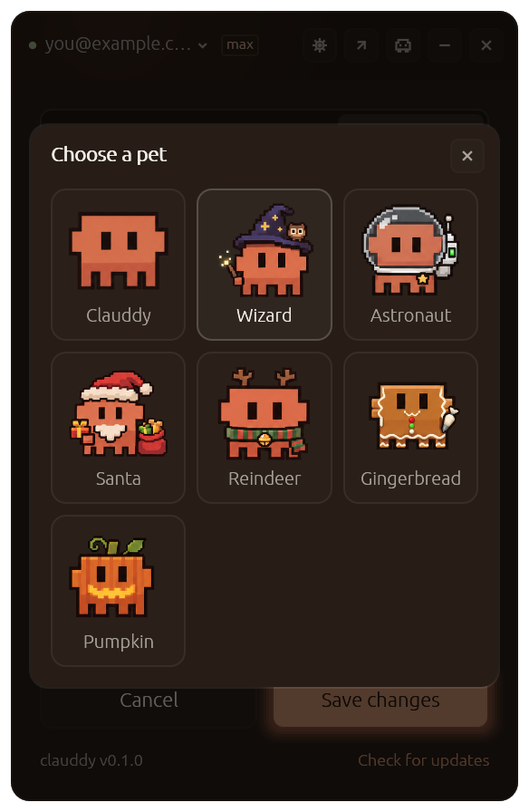

# Pets

The pets Clauddy can wear besides the classic sprite: the catalog and its packs, how a pet is drawn, the holiday rule, and how to add one.

## Overview

**⚙ Settings → Appearance → pet** shows the current pet and **Change**, which opens a modal over the card with each pet's idle pose. A pick previews at once and closes it (so do Esc, ✕ and a click outside); **Save** keeps it as `config.pet`, **Cancel** puts the saved one back. An unknown id falls back to the classic sprite and is kept in `config.json` as it was.

| Pack | Pets | Its days |
|---|---|---|
| Everyday | Clauddy (the classic sprite), Wizard, Astronaut | — |
| Christmas | Santa, Reindeer, Gingerbread | December 24 and 25 |
| Halloween | Pumpkin | October 31 |

## How a pet is drawn

A pet is a pair of sprite sheets in the classic sprite's layout, generated in its art style rather than drawn in code ([ADR-013](../decisions/ADR-013-pets-are-generated-sprite-sheets.md)):

- **Working**, 4 × 2 frames at 1024 × 512: the pet at its desk, typing, blinking, struggling and cheering.
- **Moods**, 4 × 4 frames at 1024 × 1024: one row each for idle, sleeping, on fire and maxed out.

Each pet is a `Skin` in `native/src/components/skins.rs`, with the sheets compiled into the app and three boxes that say where the art sits in a frame: the whole desk scene, the body with its flames, and the body standing. The standing box keeps the pet the same size and on the same baseline across moods; a sheet is decoded the first time its pet is shown.

## Holidays

On a pack's days, one of its pets takes over ([ADR-009](../decisions/ADR-009-holiday-pet-by-hash.md)):

- **One per pack and year**, chosen by a hash of the year and the pack, so the pick holds all day and across restarts without being stored, and changes from year to year.
- The pet is chosen again every frame, so the switch happens at midnight with the app open.
- The saved pick is untouched and comes back the next day. A pack with no pets would leave the saved pick alone.

## Adding a pet

1. Generate both sheets from `native/assets/working-sheet.png` and `native/assets/moods-sheet.png` as the reference: the same frames, the same character size and position, on a flat background. The art is generated (Codex `gpt-6-astra`), and Clauddy stays square and blocky.
2. Clear the background, resize to 1024 × 512 and 1024 × 1024, and measure the art's box in each row.
3. Add the sheets to `native/assets/` and a `Skin` to `SKINS`, with its pack. A new pack goes in `PACKS`, with `days` if it takes over on holidays.
4. Add snapshot cases named after the pet (`<id>-expanded`, `<id>-compact-fire`, ...) in `native/src/screens/snapshots.rs`, and check the PNGs: a test checks that every sheet has its grid's size.
