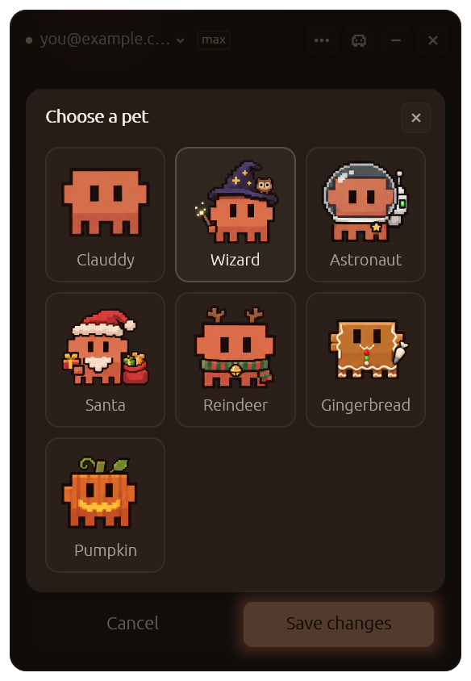
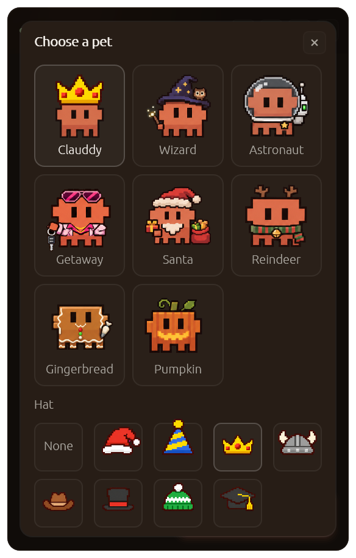

# Pets

The pets Clauddy can wear besides the classic sprite: the catalog and its packs, how a pet is drawn, the holiday rule, and how to add one.

## Overview

**⚙ Settings → Appearance → pet** shows the current pet and **Change**, which opens a modal over the card with each pet's idle pose. A pick previews at once and closes it (so do Esc, ✕ and a click outside); **Save** keeps it as `config.pet`, **Cancel** puts the saved one back. An unknown id falls back to the classic sprite and is kept in `config.json` as it was.

| Pack | Pets | Its days |
|---|---|---|
| Everyday | Clauddy (the classic sprite), Wizard, Astronaut, Getaway | — |
| Christmas | Santa, Reindeer, Gingerbread | December 24 and 25 |
| Halloween | Pumpkin | October 31 |

The picker opens from **⚙ Settings → Appearance → Pet**, where the pick waits for **Save**, or from the title band's **⋯ → Change pet**, where it takes at once and closing the picker goes back to the widget.

## How a pet is drawn

A pet is a pair of sprite sheets in the classic sprite's layout, generated in its art style rather than drawn in code ([ADR-013](../decisions/ADR-013-pets-are-generated-sprite-sheets.md)):

- **Working**, 4 × 2 frames at 1024 × 512: the pet at its desk, typing, blinking, struggling and cheering.
- **Moods**, 4 × 4 frames at 1024 × 1024: one row each for idle, sleeping, on fire and maxed out.

Each pet is a `Skin` in `native/src/components/skins.rs`, with the sheets compiled into the app and three boxes that say where the art sits in a frame: the whole desk scene, the body with its flames, and the body standing. The standing box keeps the pet the same size and on the same baseline across moods; a sheet is decoded the first time its pet is shown.

Every sheet is generated at the classic sprite's scale, so in pet-only size every pet is drawn with the same frame size and has the same body; what it wears (the Wizard's hat, Santa's sack) spills past it instead of shrinking the pet. The desk scenes are drawn in the same frame, where the pet sits a little smaller (0.84 of its standing size), so the scene with its desk stays close to the standing pet's size. An act strip has an `act_scale`, how wide its frame is drawn against a standing one, set so the pet in it is the size it is everywhere else (Santa's sleigh a little smaller, far up in the sky).

## Hats and play

A pet with a number of its own on the screen ([features](02-features.md#just-the-pet-at-play)) has an **act** strip, 4 × 1, generated like its other sheets, and an `act_box` that says where the art sits in a frame:

- **Getaway** (`getaway-act.png`, 1024 × 256): the car driving (two frames of turning wheels and exhaust, one fast with speed lines) and waving at you.
- **Santa** (`santa-act.png`, 2048 × 256, frames twice as wide as tall): the sleigh and two reindeer galloping, and Santa waving. The presents he drops are `gifts.png`, four boxes.
- **Gingerbread** (`gingerbread-act.png`, 1024 × 256): a running cycle of three frames, and the tease.
- **Reindeer** (`reindeer-act.png`): a flying gallop of three frames, and a wave with its nose aglow.
- **Wizard** (`wizard-act.png`): the wand raised, sparks shot, a poof of smoke (no wizard in it), and a wave.
- **Astronaut** (`astronaut-act.png`): riding a little rocket, with two sizes of flame, cruising, and a wave; drawn turned to the way it flies.
- **Pumpkin** (`pumpkin-act.png`): cackling, then its bat (wings up and down) and its ghost, which fly on their own.
- **Clauddy** (`clauddy-act.png`): its wave, for the peekaboo; the peeking itself is its own idle pose, drawn only above the window's edge.

Every pet in the catalog has one. A new pet without an act strip hops onto a window instead.

The classic Clauddy has two more sheets:

- **Play**, 4 × 1 frames at 1024 × 256 (`clauddy-play.png`): crouching, jumping, falling and dizzy, for when it plays on the screen ([features](02-features.md#just-the-pet-at-play)). A pet without this strip plays with its moods: its idle face going up, its tired one coming down.
- **Hats**, 4 × 2 frames at 1024 × 512 (`hats.png`): Santa, party, crown, viking, cowboy, top hat, beanie and grad cap, in the same pixel style.

A hat is picked under the pets in the pet picker, which shows the hats while Clauddy is the pet; a pick takes at once and leaves the picker open, and it is kept as `config.hat` (`""` for none). Only the classic Clauddy wears one: the other pets come dressed. The hat sits on the head in every frame from a table of where the head is in each one (`head` in `components/pet.rs`, measured from the sheets), and a pet in a hat is fitted with the hat, so the glance above it clears the hat.

## Holidays

On a pack's days, one of its pets takes over ([ADR-009](../decisions/ADR-009-holiday-pet-by-hash.md)):

- **One per pack and year**, chosen by a hash of the year and the pack, so the pick holds all day and across restarts without being stored, and changes from year to year.
- The pet is chosen again every frame, so the switch happens at midnight with the app open.
- The saved pick is untouched and comes back the next day. A pack with no pets would leave the saved pick alone.

## Adding a pet

1. Generate both sheets from `native/assets/working-sheet.png` and `native/assets/moods-sheet.png` as the reference: the same frames, the same character size and position, on a flat background. The art is generated (Codex `gpt-6-astra`), and Clauddy stays square and blocky.
2. Clear the background, resize to 1024 × 512 and 1024 × 1024, and measure the art's box in each row.
3. Add the sheets to `native/assets/` and a `Skin` to `SKINS`, with its pack. A new pack goes in `PACKS`, with `days` if it takes over on holidays.
4. Add snapshot cases named after the pet (`<id>-expanded`, `<id>-compact-fire`, ...) in `native/src/screens/snapshots.rs`, and check the PNGs: a test checks that every sheet has its grid's size.
