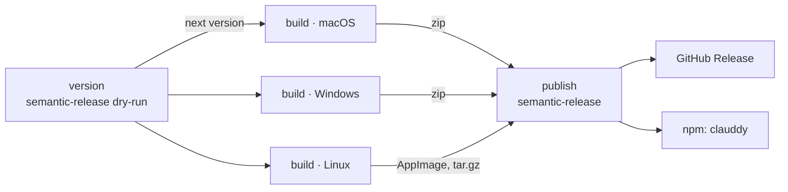

# Releases

How a merge becomes a release: the version, the builds on each platform, and what gets published where.

## Overview

Every merge to `main` runs `.github/workflows/release.yml`. [semantic-release](https://semantic-release.gitbook.io) reads the Conventional Commit titles since the last tag and decides whether there is something to ship and which version it is. Nothing is done by hand.

| Title type | Release |
|---|---|
| `feat:` | Minor (`1.28.3` → `1.29.0`) |
| `fix:`, `perf:` | Patch (`1.28.3` → `1.28.4`) |
| `feat!:` or a `BREAKING CHANGE` footer | Major |
| `docs:`, `chore:`, `ci:`, `test:`, `refactor:`, `style:`, `build:` | None |

Pull requests are squash-merged, so the PR title is the commit semantic-release reads.

## The pipeline

electron-builder cannot reliably build Windows and Linux apps from macOS, so each platform builds on its own runner ([ADR-010](../decisions/ADR-010-build-on-each-platform.md)), in three stages:

1. **version**: lints, then runs semantic-release as a dry run to compute the next version. With nothing to ship the pipeline stops here.
2. **build**: one job per platform stamps that version into `package.json` (`scripts/set-version.js`), so the file names are right, and runs `bun run dist`, `dist:win` or `dist:linux`.
3. **publish**: downloads every artifact and runs semantic-release for real: the tag `vX.Y.Z`, the GitHub Release with the macOS, Windows and Linux files attached, and `clauddy` on npm for `bunx clauddy`.

## What ships

| Platform | File | Installed by |
|---|---|---|
| macOS (Apple Silicon) | `Clauddy-<version>-arm64-mac.zip` | `install.sh` and the in-app update |
| Windows (x64) | `Clauddy-<version>-win-x64.zip` | Unzipping it |
| Linux (x64) | `Clauddy-<version>-linux-x86_64.AppImage`, `Clauddy-<version>-linux-x64.tar.gz` | Running the AppImage |
| Any | `clauddy` on npm | `bunx clauddy`, `npx clauddy` |

The macOS bundle is ad-hoc signed with the real app id after packing (`scripts/adhoc-sign.js`), which keeps notifications working; it is not notarized, which is why `install.sh` exists ([setup](03-setup.md#macos)).

Locally, `bun run pack` builds `dist/mac-arm64/Clauddy.app` to check that the app still builds and launches.
