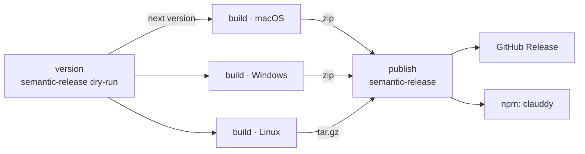

# Releases

How a merge becomes a release: the version, the builds on each platform, and what gets published where.

## Overview

Every merge to `main` runs `.github/workflows/release.yml`. [semantic-release](https://semantic-release.gitbook.io) reads the Conventional Commit titles since the last tag and decides whether there is something to ship and which version it is. Nothing is done by hand.

| Title type | Release |
|---|---|
| `feat:` | Minor (`1.28.3` → `1.29.0`) |
| `fix:`, `perf:` | Patch (`1.28.3` → `1.28.4`) |
| `feat!:` or a `BREAKING CHANGE` footer | Major |
| `docs:`, `chore:`, `ci:`, `test:`, `refactor:`, `style:`, `build:` | None |

Pull requests are squash-merged, so the PR title is the commit semantic-release reads.

## The pipeline

The app is the native one in `native/` ([ADR-012](../decisions/ADR-012-the-native-app-replaces-electron.md)), and each platform builds on its own runner ([ADR-010](../decisions/ADR-010-build-on-each-platform.md)), in three stages:

1. **version**: lints the launcher, then runs semantic-release as a dry run to compute the next version. With nothing to ship the pipeline stops here.
2. **build**: one job per platform installs the Rust toolchain (and GTK on Linux, for the tray) and runs `native/scripts/package.sh <version>`, which stamps the version into `native/Cargo.toml`, builds the app and packs it into `dist/`.
3. **publish**: downloads every artifact and runs semantic-release for real: the tag `vX.Y.Z`, the GitHub Release with the macOS, Windows and Linux files attached, and `clauddy` on npm for `bunx clauddy`.

## What ships

| Platform | File | Installed by |
|---|---|---|
| macOS (Apple Silicon) | `Clauddy-<version>-arm64-mac.zip`: `Clauddy.app` | `install.sh` and the in-app update |
| Windows (x64) | `Clauddy-<version>-win-x64.zip`: `Clauddy.exe` | Unzipping it |
| Linux (x64) | `Clauddy-<version>-linux-x64.tar.gz`: `Clauddy/clauddy` and its icon | Unpacking it |
| Any | `clauddy` on npm: a launcher that downloads the release's file for the OS ([ADR-014](../decisions/ADR-014-npm-launches-the-native-app.md)) | `bunx clauddy`, `npx clauddy` |

The macOS bundle is built by `native/scripts/bundle.sh` and ad-hoc signed under the real app id, `app.clauddy`, which keeps notifications working; it is not notarized, which is why `install.sh` exists ([setup](03-setup.md#macos)). A development bundle uses `app.clauddy.dev`, so it never mixes with the installed app.

The app checks the latest release 8 seconds after launch and every 6 hours, marking the gear when one is newer; Settings > Check for updates asks at once. On macOS, updating runs `install.sh` and quits so it can replace the app; on Windows and Linux it opens the release page.

Pull requests build the native app on all three platforms, check its formatting, and run its tests (with the snapshot gallery) on macOS; they also lint and test the launcher.

Locally, `native/scripts/bundle.sh` builds `native/target/Clauddy.app`, and `native/scripts/package.sh <version>` the artifact a release would ship.
