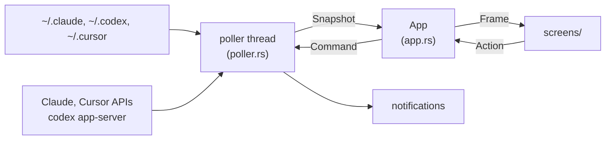

# The native app

How the app in `native/` is built: Rust with eframe/egui, no webview ([ADR-012](../decisions/ADR-012-the-native-app-replaces-electron.md)). It reads and writes the same files as the Electron app, so the notes on [usage](04-usage.md) and [alerts](05-alerts.md) hold for both; this note covers what is particular to it.

## Overview

One window, drawn immediately by egui, and one background thread that reads everything. The window repaints only when something changes: a new reading, the pet's next frame, an animation, the pointer.

- **The poller** (`poller.rs`) reads the Claude logs (`usage.rs`), the account's % (`auth.rs`, on the Electron app's schedule), Codex (`codex.rs`) and Cursor (`cursor.rs`), checks the alerts (`alerts.rs`) and the reset reminders (`reminders.rs`), and publishes a `Snapshot`. Commands from the window (switch account, log in, save settings, arm a reminder) reach it over a channel and are answered at once, followed by a fresh poll.
- **The app** (`app.rs`) holds what is on screen: the size, the open tab, the settings draft, the speech bubble. Each frame it builds a `Frame` from the latest snapshot and hands it to the screen.
- **The screens** (`screens/`) draw only from the `Frame` and return `Action`s for the app to apply. They never read the poller, the disk or the clock on their own, which is what lets the snapshot gallery render every state from fixtures.

## Code layout

| Where | What |
|---|---|
| `src/ui/` | Generic pieces that know nothing about Clauddy: the theme tokens, icons, controls, surfaces, bars, tags, text |
| `src/components/` | Clauddy's own pieces: the pet, logos, account chip, service rows, meters, status line, breakdowns, heat map, the glance and speech bubbles, the reminder button |
| `src/screens/` | Compact, expanded, pet-only and Settings, and the snapshot gallery |
| `src/platform/` | What the OS has to answer: the cursor watcher, the tray, login items, activation |
| `src/voice.rs`, `src/talk.rs` | The pet's remarks and blips, and when it says them |
| `src/updates.rs` | The release check and the installer |

The theme (`ui/theme.rs`) keeps the raw palette private; everything else uses semantic names, and a test fails on a raw colour anywhere else.

## The window on macOS

Floating, the window is a fixed transparent canvas and the card lives inside it: the window never resizes, because a resize shows one empty frame that reads as a blink. Changing size morphs the card within the canvas instead. Clicks off the card fall through to what is behind: a light thread (`platform/cursor.rs`) reads the cursor's screen position every 40 ms and turns click-through on only while the cursor is outside the card (or, in pet-only, outside the pet and its glance).

In the menu bar the window is an ordinary one the card's size, shown under the icon as a popover that closes when it loses focus. It is shown from a timer once the bar's menu has closed: shown from the menu's own handler, macOS hands the next click to the app that was in front.

A hidden window gets no frames, so anything that must happen while it is hidden (the menu's picks) puts it back on screen first.

## Pets

A pet is a pair of sprite sheets in Clauddy's layout, working (4 × 2) and moods (4 × 4), listed in `src/components/skins.rs` with where the art sits in each frame ([ADR-013](../decisions/ADR-013-pets-are-generated-sprite-sheets.md)). Settings > Appearance > Change opens a picker with each pet's idle pose; the choice is `config.json`'s `pet`, previewed while Settings is open. On a pack's days (Halloween, Christmas) one of its pets takes over, picked by a hash of the year, as in the Electron app; a pack with no native pets yet leaves the choice alone.

To add a pet: generate both sheets from `assets/working-sheet.png` and `assets/moods-sheet.png` as reference (same frames, same size and position), clear the flat background, resize to 1024 × 512 and 1024 × 1024, measure the art's box per row, and add a `Skin`. A snapshot case shows it in every size.

## Notifications, login and updates

- **Notifications** go through `UNUserNotificationCenter`, from a signed bundle only; at launch the app comes to the front and asks for permission. The loose binary can't notify.
- **Open at login**: the released app registers itself (macOS `SMAppService`, the Windows Run key, a Linux autostart entry); development builds never do.
- **Updates**: see [releases](07-releases.md).

## Files

Shared with the Electron app, in `~/.claude-usage-monitor/`: `config.json` (only the keys the native app edits are rewritten), `accounts.json`, `auth.json` and `alerts.json` per account, `reset-reminders.json`. Its own: `native-ui.json` (size, open sections, the service shown), `native-voice.json` (once-a-day remarks), and `limits-cache.json` per account (the last reading and the polling schedule).

## Tests

`cargo test --release` in `native/` runs the unit tests (each reader is a port of its JS module and of its tests) and the snapshot gallery: `src/screens/snapshots.rs` renders every screen state into `native/tests/snapshots/*.png` and fails when a render drifts. After an intended change, `UPDATE_SNAPSHOTS=1 cargo test --release` rewrites them; review the PNGs before committing.
